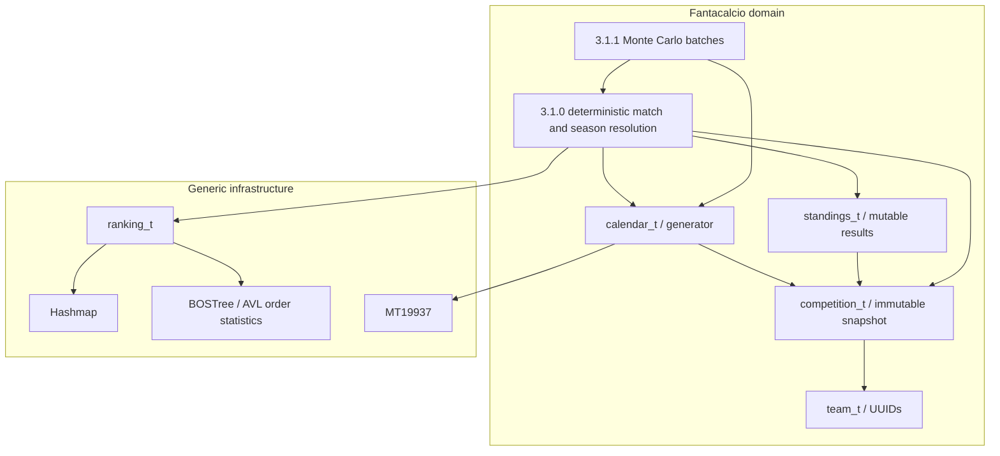

<div align="center">
  <h1>Central Ranking Dogma</h1>
  <p><strong>Deterministic ranking and constrained calendar experiments in ISO C11.</strong></p>
  <p>
    A reusable native library for Fantacalcio competition snapshots, fixture permutations,
    match and season resolution, and Monte Carlo counterfactual analysis.
    Its independent <code>crd-json</code> subprocess adapter exposes these computations
    to external applications without introducing Python or JSON into the C library.
  </p>
  <p>
    <a href="https://github.com/AlessVolpe/CentralRankingDogma/actions/workflows/ci.yml"></a>
    <a href="https://github.com/AlessVolpe/CentralRankingDogma/releases"></a>
    <a href="https://github.com/AlessVolpe/CentralRankingDogma"></a>
    <a href="native/include/"></a>
    <a href="LICENSE"></a>
  </p>
  <p>
    <a href="#read-the-research-or-use-the-library">Overview</a> ·
    <a href="#internal-c-architecture">Architecture</a> ·
    <a href="#deterministic-match-and-season-resolution-310">Resolution</a> ·
    <a href="#monte-carlo-experiments-311">Monte Carlo</a> ·
    <a href="#composite-ranking-and-scientific-evaluation-312">Evaluation</a> ·
    <a href="#mathematical-foundation">Mathematics</a> ·
    <a href="#quick-build">Build</a> ·
    <a href="#reproducibility-and-history">Reproducibility</a>
  </p>
</div>

---

**Current native version:** 3.1.4 (first official release). Central Ranking Dogma provides a reusable ISO C11 library, an independently installed JSON subprocess adapter, and a controlled research toolkit. The default ranking backend remains heapsort, with an optional composite-key AVL backend. The composite-key AVL backend and [controlled research toolkit](research/README.md) remain available, with [published 3.1.2 evaluation](docs/research/results-3.1.2.md). The default ranking backend is heapsort. The separately installed `crd-json` executable exposes JSON CLI v1 (`validate`, `generate`, `resolve`, `simulate`); the native library remains JSON-free. See [integration contract](docs/integration/json-cli-v1.md) and [packaging](docs/development/packaging.md).

## Read the research or use the library

- **Research path:** [Scientific documentation](docs/index.md#research-reading-path), [notation](docs/notation.md), [calendar mathematics](docs/reference/calendar.md), [match scoring](docs/reference/match.md), [season resolution](docs/reference/season-resolution.md), [Monte Carlo experiments](docs/reference/monte-carlo.md), [methodology](docs/research/methodology.md), [bibliography](docs/bibliography.md).
- **Developer path:** [Library reference](docs/index.md#developer-reading-path), [repository layout](docs/development/repository-layout.md), [local verification](docs/development/local-verification.md), [packaging](docs/development/packaging.md), [public headers](native/include/), [current C architecture](docs/architecture/internal-c.md).
- **Development record:** [Roadmap and milestone ledger](docs/roadmap.md); the original documentation is [archived](docs/archive/README.md), not discarded.

## Internal C architecture

The native dependency/ownership relationships are the center of the current architecture. Arrows indicate **uses or constructs**, not necessarily ownership; consult the [architecture contract](docs/architecture/internal-c.md) for the distinct lifetimes.



Explore the additional [system boundary](docs/architecture/system.md) and [scientific data-flow](docs/architecture/data-flow.md) diagrams. Solid arrows indicate implemented module relationships. The new `MATCH --> RANK` arrow identifies the optional, composite-key AVL backend in `season_resolve_with_options()`; legacy `season_resolve()` still uses heapsort. The Python application remains separate.

## Deterministic match and season resolution (3.1.0)

The original fixture schedule is the essential research baseline. `match_rules_default()`
uses the league's thresholds 66, 70, ..., 94 and an additional goal every four
points after the eighth, with optional victory/draw limitations disabled.
`season_resolve()` evaluates either the original schedule or a validated
alternative, using the same immutable matchday scores. It supports complete
seasons and the maximal contiguous prefix of finalized rounds, then publishes
owned fixture results and ranked standings (league points, resolved-round
fantasy totals, goal difference, shared exact ties). The [match paper](docs/reference/match.md)
and [season paper](docs/reference/season-resolution.md) specify the proofs,
errors, complexity and empirical baseline. The implemented Monte Carlo
orchestrator calls this deterministic resolver for each accepted calendar.

## Monte Carlo experiments (3.1.1)

`monte_carlo_run()` evaluates seeded batches of generated calendars, retaining
an independently resolved historical baseline and online team-by-rank statistics.
It supports complete seasons or a nonempty finalized prefix, duplicate-inclusive
sampling (default), optional exact directed-prefix uniqueness, finite generation
budgets, cooperative cancellation, and raw plus aggregate CSV. The configured
sampler is **not proven uniform** and observed frequencies must not be labelled
population championship-winning probabilities. See the [Monte Carlo research
paper](docs/reference/monte-carlo.md) and [milestone](docs/milestones/3.1.1.md).

Optional home-field fantasy-score bonuses are off by default and can be
suppressed throughout the final, potentially partial round-robin cycle.

## Composite ranking and scientific evaluation (3.1.2)

`ranking_t` retains its signed-score API and supports copied fixed-size keys
with a caller-provided comparator and borrowed context. The optional AVL-backed
season resolver uses the sporting key
`(championship_points, fantasy_total_tenths, goal_difference)` while preserving
shared competition positions and UUID display order. The original heapsort is
still the default and correctness reference. `monte_carlo_options_t` selects
one backend for both its historical baseline and all sampled calendars.
The [3.1.2 research framework](research/README.md) implements paired static
and incremental ranking benchmarks, separately instrumented stage measurements,
whole-process Massif heap profiles and reproducible Monte Carlo analysis.
The [measured 3.1.2 results](docs/research/results-3.1.2.md) provide the
scientific interpretation and evidence hashes. Heapsort is faster for batch
construction at all recorded sizes; AVL becomes advantageous for larger
incremental-update workloads at a memory cost. Only synthetic, independent
recombination sampling was evaluated, not uniform-calendar probabilities.

## Mathematical foundation

For an even number of teams $N$, a league round is a perfect matching $M_r$ of the team set $V$. The strict no-rematch-until-all-opponents rule implies an unordered fixture period $P=N-1$:

```math
|M_r| = \frac{N}{2},\qquad
\biguplus_{r=0}^{N-2}M_r=E(K_N),\qquad
M_{r+N-1}=M_r.
```

Calendar generation must preserve the original **directed** encounter counts $D_0(a,b)$, including home/away orientation:

```math
D_G(a,b)=D_0(a,b),\qquad
D_G(a,b)+D_G(b,a)=C_0(a,b).
```

Separate standings have the invariant $P_{\mathrm{league}}=3W+D$, whereas the original team fantasy scores remain fixed by Serie A matchday. The generic ranking abstraction orders signed scores descending, then identifiers ascending. Detailed proofs, algorithms, asymptotic bounds and scientific limitations belong to the respective [module sub-papers](docs/index.md#module-sub-papers), not to this overview. The scheduling model follows the edge-coloring perspective of [Januario et al. (2016)](docs/bibliography.md#januario-et-al-2016) and [Ribeiro et al. (2023)](docs/bibliography.md#ribeiro-et-al-2023).

<details>
<summary>What the library does not yet do</summary>

It does not reconstruct footballer bonus/malus, integrate with a database, provide a Python web application, guarantee uniform scheduling samples, or produce thesis-level statistical inference. `calendar_t` generates fixtures, `season_resolve()` evaluates them, and `monte_carlo_run()` aggregates batches. The versioned JSON subprocess transport is implemented in 3.1.3; the Python web application remains outside this repository.

</details>

## Quick build

Linux with CMake 3.16+, Ninja and GCC or Clang:

```sh
cmake -S . -B build -G Ninja -DCMAKE_BUILD_TYPE=Debug -DCRD_WARNINGS_AS_ERRORS=ON
cmake --build build --parallel
ctest --test-dir build --output-on-failure
```

The installed static-library target is `CentralRankingDogma::central_ranking_dogma` (`libcentral_ranking_dogma.a` on Linux). The umbrella header is `central_ranking_dogma.h`; legacy `Leaderboard` package aliases are not supplied. The
installed `crd-json` executable is a separate subprocess integration
surface. `crd-json --version` prints the native package version.
See [building](docs/development/building.md) for Linux and Windows UCRT64,
sanitizers and Release configurations; see [packaging](docs/development/packaging.md)
for installed consumers and [migration notes](docs/development/migration-3.1.4.md)
for renamed developer interfaces. The educational `crd-cli` remains separate.

## Reproducibility and history

The [research methodology](docs/research/methodology.md) separates mathematical correctness, deterministic replay, diversity diagnostics, and statistical representativeness. The [milestone ledger](docs/roadmap.md) links each change to its implementation and verification evidence. Historical documents remain available in the [archive](docs/archive/README.md), with [third-party provenance](THIRD_PARTY_NOTICES.md) and [GPL-3.0-only licensing](LICENSE) preserved.
