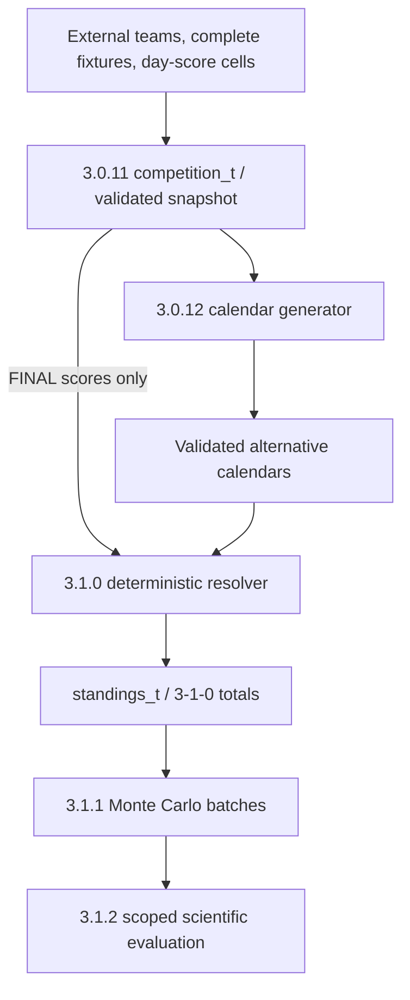

# Scientific data flow and validity gates

**Solid arrows:** implemented snapshot import, fixture generation, season resolution, Monte Carlo batching and bounded 3.1.2 scientific evaluation. The original calendar is evaluated independently as a baseline without passing through the generator. Heapsort remains the default; an optional hashmap/BOSTree-backed composite-key `ranking_t` path is implemented and tested. The planned 3.1.3 [JSON CLI](../integration/json-cli-v1.md) is an external transport boundary, not a new competition calculation.

A structurally valid competition can contain `PENDING` scores. Calendar generation accepts this input. The 3.1.0 resolver permits a fully FINAL season or the maximal consecutive FINAL round prefix; it never treats pending scores as zero. The [research methodology](../research/methodology.md) describes evaluation without inventing missing results.
