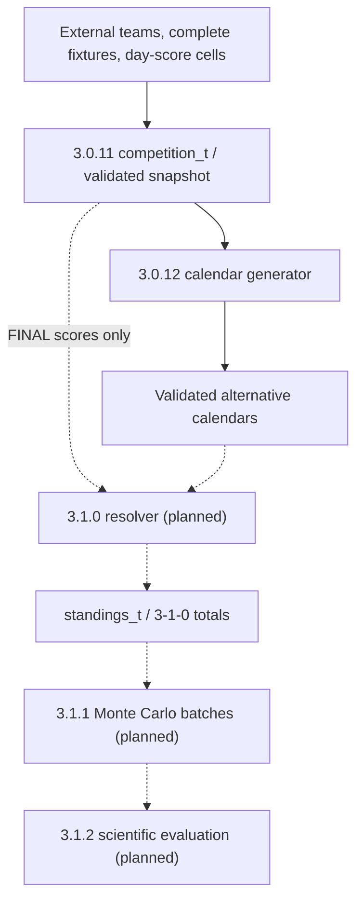

# Scientific data flow and validity gates

**Solid arrows:** implemented import/fixture generation. **Dashed arrows:** intended downstream use, some components not yet implemented. In particular, `standings_t` **is** implemented, but the match resolver that supplies it automatic outcomes is not.

A structurally valid competition can contain `PENDING` scores. Calendar generation accepts this input. A full-season match simulation must check `competition_is_simulation_ready` before using scores. The [research methodology](../research/methodology.md) describes evaluation without inventing missing results.
