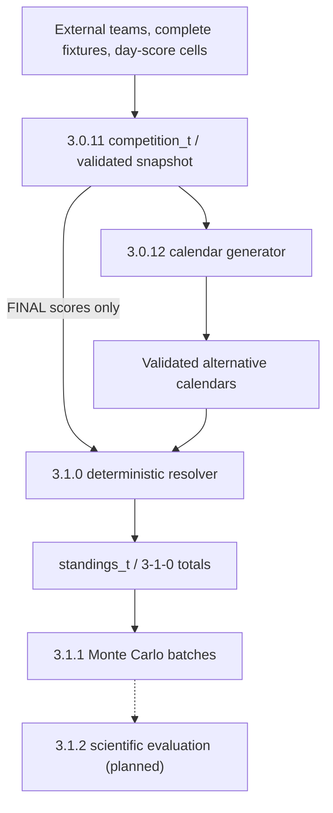

# Scientific data flow and validity gates

**Solid arrows:** implemented import, fixture generation, deterministic match/season resolution and Monte Carlo batch aggregation. **Dashed arrows:** scientific evaluation still planned for 3.1.2. The original calendar is also evaluated independently as a baseline without passing through the calendar generator.

A structurally valid competition can contain `PENDING` scores. Calendar generation accepts this input. The 3.1.0 resolver permits a fully FINAL season or the maximal consecutive FINAL round prefix; it never treats pending scores as zero. The [research methodology](../research/methodology.md) describes evaluation without inventing missing results.
