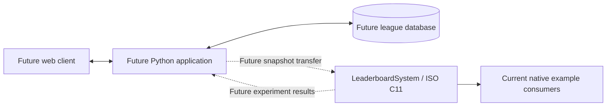

# System boundary: native C library and future application

This is a **planned integration architecture**, not an assertion that the Python application exists today. See [current C architecture](internal-c.md) for the implemented native foundation.

The eventual Python service will own league/team registration, external UUID generation, database persistence, importing the full original calendar and reporting analysis. The native library receives plain immutable input snapshots, not a database connection. The transport schema and bindings belong to [3.1.3](../milestones/3.1.3.md), **not 3.0.12**.

The generic data-structure utilities and existing example clients are already buildable in C11. The Fantacalcio match resolver and the complete simulation pipeline are scheduled separately.
