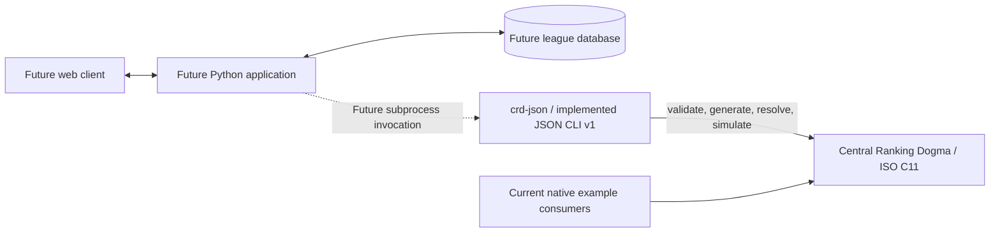

# System boundary: native C library and future application

The **native library, `crd-json` executable and independent subprocess example** are implemented. The Python web application, persistence layer and deployment worker remain planned. See [current C architecture](internal-c.md) for the installed computational foundation.

The eventual Python service will own league/team registration, external UUID generation, database persistence, importing the full original calendar and reporting analysis. The native library receives plain immutable input snapshots, not a database connection. The transport schema and bindings belong to [3.1.3](../milestones/3.1.3.md), **not 3.0.12**.

The generic data structures, Fantacalcio match/season resolver, optional composite-key AVL ranking and Monte Carlo engine are implemented in the native C11 library. The [3.1.2 controlled evaluation](../research/results-3.1.2.md) is complete within its documented experimental scope. The [3.1.3 JSON CLI contract](../integration/json-cli-v1.md) is implemented with all four operations, progress, cancellation and CSV publication; an independent Python subprocess example exercises the installed binary. The web client, database and import workflow remain outside this repository. The current source layout is documented in the [repository map](../development/repository-layout.md).
