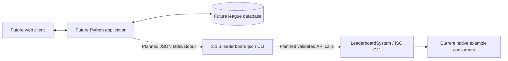

# System boundary: native C library and future application

This is a **planned integration architecture**, not an assertion that the Python application exists today. See [current C architecture](internal-c.md) for the implemented native foundation.

The eventual Python service will own league/team registration, external UUID generation, database persistence, importing the full original calendar and reporting analysis. The native library receives plain immutable input snapshots, not a database connection. The transport schema and bindings belong to [3.1.3](../milestones/3.1.3.md), **not 3.0.12**.

The generic data structures, Fantacalcio match/season resolver, optional composite-key AVL ranking and Monte Carlo engine are implemented in the native C11 library. The 3.1.2 controlled scientific evaluation is complete within its documented experimental scope. The 3.1.3 [JSON CLI contract](../integration/json-cli-v1.md) is specified by PR A; the CLI and Python subprocess consumer are **future implementation** work in later PRs. The web client, database and import workflow remain outside this repository.
